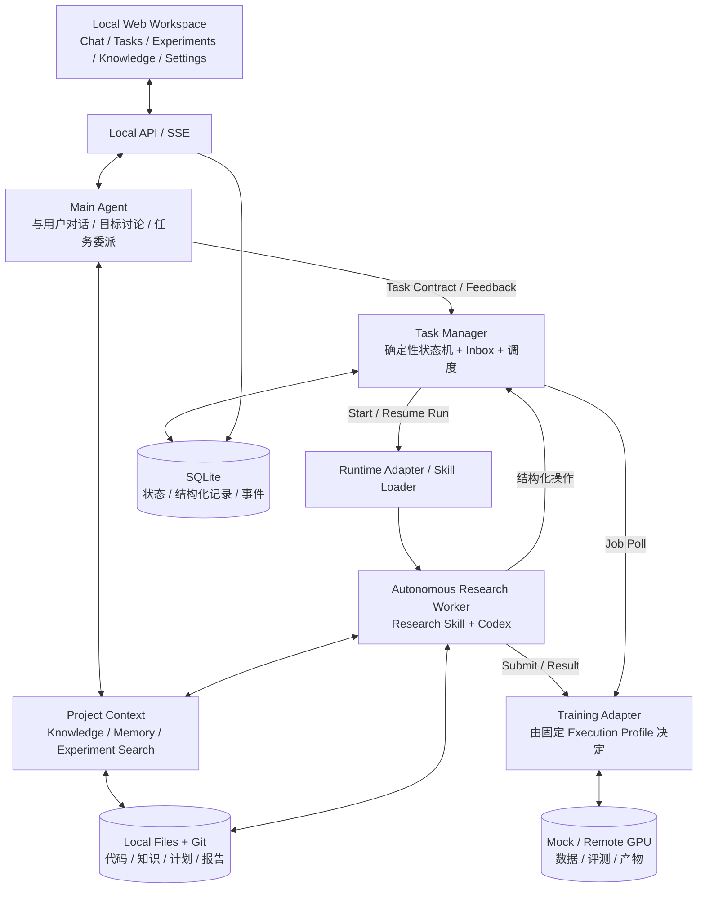
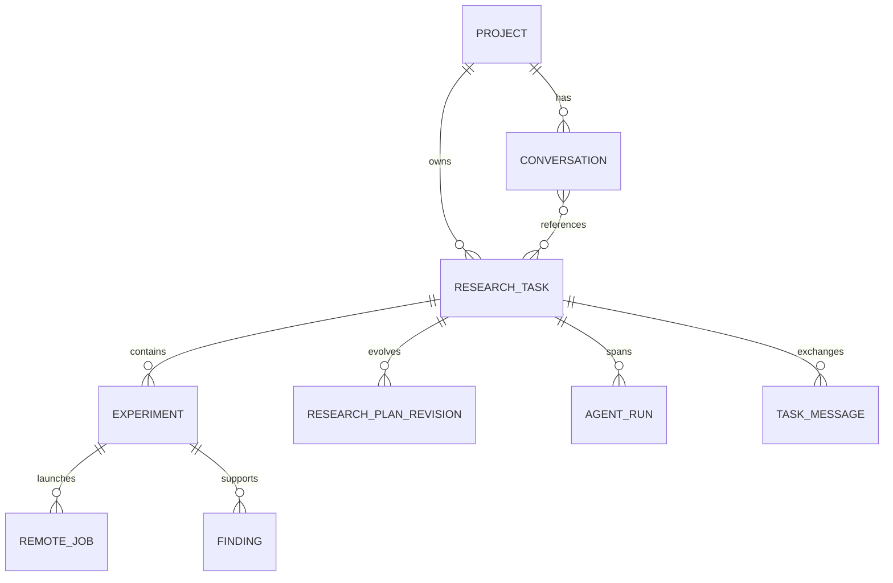
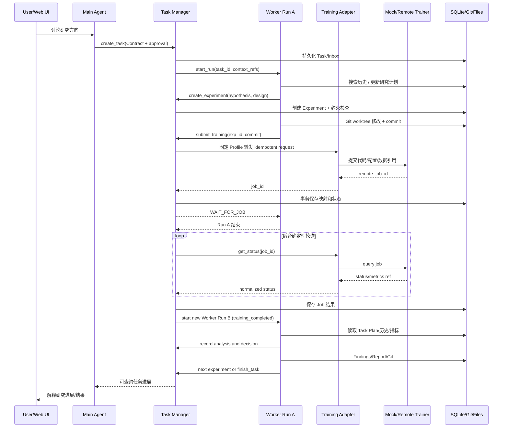

> 历史设计草案。当前目录、接口和运行方式见[架构说明](../architecture.md)。

# Autoresearch Agent MVP：详细设计与开发规格（V1.0）

> 状态：开发交接稿（待最终审阅）  
> 日期：2026-11-08  
> 读者：负责实现的 Coding Agent、技术负责人、测试 Agent  
> 语言：中文  
> 优先级：正确、可验证、可恢复 > 功能丰富 > 复杂扩展  
> **交付要求**：本文件是可直接用于实施的详细规格。实施过程中如果发现未定义或冲突之处，应写入 `docs/decisions.md`，优先采用最小、安全、可测试的实现，不得私自扩大产品范围。

---

## 0. 执行摘要

### 0.1 要做什么

构建一个 **Local-first 的自主算法研究工作台**。用户通过本地 Web UI 与 **Main Agent** 持续对话，共同制定研究方向和授权边界；Main Agent 将其转为 **Research Task** 并交给确定性的 **Task Manager**；**Research Worker** 使用 Codex 等可配置 Runtime，自主检索历史实验、形成假设、编写代码、提交模拟/真实远程训练、分析证据、更新研究计划，直到达到目标、预算或阻塞条件。用户在 Worker 工作时依然可以与 Main Agent 对话，查看实验、追加反馈、暂停和恢复。

**V1 只支持一个真实研发 Project，一个 Main Agent、每个 Task 至多一个活跃 Worker；训练环境尚未就绪，必须先提供可复现的 Mock Profile、Mock 数据和 Mock 历史实验。**

### 0.2 MVP 的真正产品价值

1. **科学研究 Harness**：系统化保存 Project → Task（研究方向）→ Research Plan（可演进研究计划）→ Experiment（单次可复现实验）→ Finding（证据支持的发现），并维护跨实验关系，避免重复且无价值的研究。
2. **Scientific Research Skill**：每次实验之前检索历史，明确假设、控制变量，分析实验可信度，对诊断结论要求可观察证据，形成下一轮策略。
3. **长期运行与人机协作**：Main 对话与 Worker 自主研究解耦；Task/Experiment/Remote Job 与短生命周期的 Agent Run 解耦；远端训练等待不消耗 LLM Token；进程退出后能够恢复。

### 0.3 固定设计原则

- **智能决策交给 Agent；持久化、权限、状态机、重试、幂等和远程环境路由交给确定性代码。**
- **Worker 不等于单次实验执行器。** 一个 Task 可包含多次 Experiment，Worker 有权限在 Task Contract 范围内自主决定下一步研究。
- Main Agent 逻辑身份长期存在，但不要求单个 LLM 进程或 Session 常驻；应用服务/Task Manager 在线时响应事件。
- 代码和知识文件保存在本地并使用 Git；活跃事务状态保存在 SQLite；训练数据、评测数据、大模型权重/Checkpoint 在远端。
- **Remote Execution Profile 由用户提前配置并固定绑定，LLM 不得选择 SSH/CLI/MCP、切换主机或自行扩大权限。**
- V1 不做多项目、论坛、多 Worker 协作、外部 Wiki/GitHub 评论事件、飞书、生产上线与自动部署。

---

## 1. 范围、用户故事与验收标准

### 1.1 In-scope

- 单 Project 初始化（Bootstrap）和 READY 校验。
- 本地 Web 工作台：Chat、Tasks、Experiments、Knowledge、Settings；提供 CLI 调试入口。
- Main Agent 对话：项目知识检索、研究方向讨论、草拟/更新 Task Contract、人工确认、委派、查状态、反馈与控制。
- Worker 自主研究：历史检索、计划、提出假设、编码、训练、评测、分析、结论、下一轮循环；使用 Codex Runtime Adapter，其他 Runtime 仅预留扩展。
- Task Manager：任务/实验/Run/远端 Job 状态机、异步调度、Inbox、恢复、控制、幂等、安全边界。
- Scientific Research Skill + 研究数据校验 Harness。
- Mock CLI/训练 Adapter：可控延迟、指定指标、确定性失败、模拟断连和重复通知。
- 本地 Git + Markdown + JSONL + SQLite，UI 展示持久化状态与实验详情。
- 可配置 Runtime、Skills 与 Execution Profile，配置生效与版本可追溯。

### 1.2 Non-goals

- 不开发通用 Coding Agent 的推理内核、ReAct Loop、代码编辑器或 Shell Agent。
- 不重新实现 GPU 调度平台；真实企业训练平台只通过 Adapter 接入。
- 不做通用多 Agent 平台、复杂权限中心、向量知识库、实验自动上线、跨项目共享。
- 不要求本地电脑关闭后持续自主研究：远端已提交作业可以继续；本地研究决策在重新启动后恢复。
- Mock 训练的指标提升不证明真实算法科学能力，MVP 科学质量测试需另外验证行为和证据标准。

### 1.3 用户故事

US-01：作为用户，我可以在 UI 中输入仓库、训练入口、数据资源引用和评测定义，Bootstrap 自动生成项目知识并检测 Mock 环境。  
US-02：我可以和 Main Agent 讨论研究方向，在确认合同之前不产生实际训练任务。  
US-03：我批准后，Worker 能自主连续完成至少 5 轮有效 Mock 实验，无需逐轮审批。  
US-04：Worker 提交训练后退出，当训练完成时被新的 Run 唤醒，并继承研究背景。  
US-05：我可以在 Worker 研究期间继续对话、查看进展、留下建议、暂停/恢复/取消。  
US-06：我能查看每轮实验假设、控制变量、代码版本、Job ID、数据/评测版本、指标、原始证据链接、结论级别和下一步。  
US-07：研究记录跨应用重启保存，且出现提交超时、进程崩溃或重复事件不会产生重复 GPU 作业。  
US-08：Remote Execution Profile 在 Settings 中绑定；Worker 只能调用统一 Training Tool，不能动态选择远程执行通道。

### 1.4 上线门槛（全部必须通过）

- 至少一条真实的 Main → Task Manager → Worker → Mock Training → Worker → Main/UI 完整闭环。
- Mock 模式至少 5 轮已完成且有效的实验（失败和超时单独记录，不计入有效轮数）。
- 同一任务的 Worker Run 至少跨一次进程终止/重启；继续研究时能正确识别 `task_id` 和最近历史。
- Main Agent 在 Worker 等待/执行期间可聊天、查状态、发送反馈；反馈最多被处理一次（幂等）。
- 任何未授权的 `evaluation` / 数据修改、超预算训练提交都会被程序阻断。
- 不存在 Task、Experiment、Run、Job 的错误关联；所有外键和归属检查通过。
- 任意已提交远端任务可从持久化 Job ID 恢复查询；提交超时不会盲目重试。
- 研究结论从证据记录可追溯；不允许把无证据机制推断标记为 validated。
- 用户能够从 Web UI 查看 Task → 实验 → Git Diff / Metrics / Findings。
- 测试报告包含执行命令、通过率、失败修复和剩余风险；代码已经初始 Git 提交。

---

## 2. 逻辑架构与部署模型



### 2.1 本地部署

单机进程组合即可。建议 Python 3.11+、FastAPI、SQLite、Git、React + TypeScript + Vite。后端可为单进程 API + 一个受控后台调度循环；Worker 作为独立子进程启动；不要一开始做微服务。SSE 用于服务器推送聊天/任务状态；普通 HTTP 用于写操作。

若系统采用其他语言或技术栈，必须保持本文协议与验收能力不变。

### 2.2 四个逻辑模块

| 模块 | 决策类型 | 数据读写 | 生命周期 |
|---|---|---|---|
| Main Agent | LLM：交互、理解用户、任务目标/边界协商 | 读取 Project/Task 摘要；通过 Tool 写命令，不直接写任务状态 | 长期身份，按消息发起 Run |
| Project Context | 无决策；知识文件、索引和检索 | Git/Markdown/JSONL/只读 SQLite 查询 | 与 Project 一同存在 |
| Task Manager | **无 LLM**；确定性调度、约束、状态与恢复 | SQLite 唯一权威写入；统一 Tool API | 本地服务运行时常驻 |
| Research Worker | LLM：实验假设、研究计划、证据分析、下一轮 | Worktree/研究文件；结构化 Tool 操作实验/Job | Task 长期，Run 短期 |

**边界警告**：Main Agent 和 Worker 不可通过直接共享可变进程内状态协调；不能让 Main Agent 逐轮决定研究策略；不能让 Worker 绕过 Task Manager 直接变更合同/受保护评测。

### 2.3 Agent 身份、Task、Experiment、Run 与 Job

- **Agent Definition**：长期配置，包括 role、instructions、runtime、model、skills、tool permission。
- **Conversation**：持续用户对话对象。Conversation 与 Task 是多对多引用关系（V1 最简单可使用关联表）；不是同一个 Thread。
- **Research Task**：一次委托的研究方向、目标与边界，跨 Run 与多轮实验长期存在。
- **Research Plan**：Worker 对该 Task 的可演进研究计划，版本化并记录原因。
- **Experiment**：单个可比较、可复现的研究实验，记录假设、对照、改动、结果、证据。
- **Agent Run**：一次 Main 或 Worker 执行；随时可退出，不能被当作 Task 的权威状态。
- **Remote Job**：一次远程训练/评测请求；可能在本地所有 Worker Run 结束后继续。
- **Finding**：有证据的科学发现与适用条件，支持/反驳关系与版本化。



---

## 3. 本地文件布局与数据权威

```text
autoresearch/
├── README.md
├── pyproject.toml
├── backend/
│   ├── api/                   # HTTP/SSE / 请求校验
│   ├── agents/                # main agent 与 worker prompts、tools
│   ├── manager/               # state machine, scheduling, inbox, recovery
│   ├── runtime/               # backend adapters 与 skill loader
│   ├── training/              # mock / cli / mcp / ssh adapters
│   ├── research/              # search, experiment validation, finding logic
│   └── storage/               # SQLite repository + file writers
├── frontend/                  # React / Vite / TypeScript
├── skills/
│   └── scientific-research/SKILL.md
├── config/
│   └── execution_profiles/
│       └── mock_local.yaml
├── workspace/                  # V1 单项目 Workspace；可配置到用户目录
│   ├── project.yaml
│   ├── AGENTS.md
│   ├── agents/main.yaml
│   ├── agents/worker.yaml
│   ├── code/                   # 独立业务 Git 仓库（嵌套或 worktree）
│   ├── knowledge/
│   │   ├── overview.md
│   │   ├── architecture.md
│   │   ├── dataset.md
│   │   ├── training.md
│   │   └── evaluation.md
│   ├── research/
│   │   ├── progress.md
│   │   ├── lessons.md
│   │   ├── experiments.jsonl
│   │   └── tasks/task_001/
│   │       ├── goal.md
│   │       ├── plan.md
│   │       ├── progress.md
│   │       ├── findings.md
│   │       └── report.md
│   └── runtime/
│       ├── state.db            # 不提交 Git
│       ├── logs/               # 不提交 Git
│       └── worktrees/          # 不提交 Git
├── tests/
│   ├── unit/
│   ├── integration/
│   ├── e2e/
│   └── fixtures/
└── docs/
    ├── architecture.md
    ├── testing.md
    └── decisions.md
```

### 3.1 唯一事实来源（Single Source of Truth）

| 内容 | 权威存储 | 镜像/展示 |
|---|---|---|
| Task/Experiment/Run/Job/Inbox 当前状态 | SQLite（事务） | SSE / Web UI |
| 代码、修改内容、版本 | 项目 Git | Experiment.code_commit、Diff 浏览 |
| 研究计划/知识/报告 | Git 管理的 Markdown | UI、SQLite 索引与缓存 |
| 实验事实 | SQLite 结构化主记录 + 追加 JSONL 审计导出 | UI/报告 |
| 数据和评测集 | 远端资源及固定版本引用 | project.yaml / experiment dataset_version |
| GPU checkpoint、原始大日志 | 远端 artifact storage | URL/URI 和摘要 |
| Secrets | OS keychain/env/企业凭据系统 | 配置只引用 secret key，不落到 Git |

避免双写引起的不一致：优先先提交 SQLite 事务，然后采用 Outbox/增量快照导出 JSONL/Markdown；导出失败可重试。JSONL 只作可读/可版本化实验日志，不能反过来覆盖现行事务状态。需要回放时使用明确的版本/检查点。

### 3.2 Git 约束

- Project Code 使用单独 Git 仓库；研究记录使用外围仓库或独立受控版本目录。
- 每次 Experiment 使用独立 worktree/commit，记录 base_commit、candidate_commit、diff hash。
- 禁止 Worker 改动 protected_paths；必须由实际文件系统权限/独立只读挂载/受控提交器执行，不能只靠 Prompt。
- 一次实验的代码 Git Commit 在训练提交之前完成，确保远端获取的是不可变代码版本。
- `runtime/`、数据和 Secrets 不进入 Git；避免自动提交未经确认的大文件。

---

## 4. Project Bootstrap（半自动初始化）

### 4.1 输入最小集

`project_name`、`repo_url / local_repo_path`、`primary_metric`、`metric_direction`、`train_entrypoint`（允许自动发现后确认）、`data_refs`（训练/验证/独立确认评测）、`execution_profile_id`、`editable_paths`、`protected_paths`、`resource_budget`。

历史 Wiki、此前实验、模型说明为可选材料，不阻塞 Mock 首次验证。未确认评测规则或权限时，不能标记 READY。

### 4.2 初始化状态机

`NEW → SCANNING → CONFIG_REVIEW → ENV_CHECK → BASELINE_PENDING_APPROVAL → BASELINE_RUNNING → READY`

异常进入 `SETUP_REQUIRED`，保留生成的配置和诊断结果，允许增量继续。

### 4.3 初始化步骤

1. 用户在 Setup 页面/CLI 提供基本信息，选择已有的 Execution Profile。导入代码仓库只读扫描。
2. Worker 读取 README、训练入口、依赖、模型、训练配置、现有知识，生成知识候选稿；每条关键事实附代码位置/来源。
3. 生成 project.yaml、AGENTS.md、knowledge/*.md 与 agent configs；不覆盖用户已审核的评测定义。
4. 确定性环境检查：Runtime 可启动、Skill 可读取、Profile 可发现、远端资源引用格式合理、Training Adapter dry-run 可成功；Mock 必须支持。
5. 用户确认代码允许修改范围、固定评测规则、GPU/实验预算和真实 Baseline 提交。
6. 记录 Baseline Experiment，包括 Git Commit、数据/评测版本、环境版本、训练结果及指标。
7. 检查全部项目最小不变量，进入 READY；所有生成内容支持后续增量扫描和人工 review。

### 4.4 示例 project.yaml

```yaml
schema_version: 1
project:
  id: demo_ctr
  name: Demo CTR Research
code:
  repo: ./code
  base_branch: main
execution:
  profile_id: mock_local
training:
  entrypoint: train.py
  train_data_ref: dataset://demo_ctr/train_v1
  validation_data_ref: dataset://demo_ctr/validation_v1
evaluation:
  evaluation_ref: eval://demo_ctr/eval_v1
  primary_metric: auc
  direction: maximize
  guardrail_metrics: [logloss]
constraints:
  editable_paths: [models/, features/, configs/]
  protected_paths: [evaluation/, data/, tests/evaluation/]
  max_parallel_jobs: 1
  max_experiments_per_task: 10
  max_training_seconds_per_job: 3600
```

---

## 5. Main Agent / Worker 的协作协议

### 5.1 控制权与自主边界

| 操作 | Main Agent | Worker | Task Manager |
|---|---|---|---|
| 研究方向讨论 | 与用户讨论 | 可建议 | 无 LLM |
| Task Contract 起草/审批 | 起草，必须人确认 | 不得自行扩权 | 校验权限并创建版本 |
| 单次实验选择 | 无需审批 | 自主 | 校验预算/权限 |
| 修改代码/训练 | 不直接做 | 自主 | 提供受控 Tool |
| 普通反馈 | 转成消息 | 在安全决策点处理 | 持久化投递 |
| 修改研究目标/评测/预算 | 需要用户确认 | 只能请求 | 拒绝未授权变更 |
| 暂停/取消 | 发起 | 遵循 | 阻止新提交、尝试取消 Job |
| 最终研究总结 | 面向用户解释 | 提供结论与证据 | 记录终态 |

### 5.2 Task Contract

```json
{
  "schema_version": 1,
  "task_id": "task_001",
  "project_id": "demo_ctr",
  "contract_version": 1,
  "title": "低频用户 CTR 泛化优化",
  "goal": {
    "objective": "提升低频用户预估质量",
    "primary_metric": "low_frequency_auc",
    "direction": "maximize",
    "guardrails": [{"metric": "overall_auc", "policy": "no_significant_regression"}]
  },
  "constraints": {
    "editable_paths": ["models/", "features/"],
    "protected_paths": ["evaluation/", "data/"],
    "evaluation_ref": "eval://demo_ctr/eval_v1",
    "max_valid_experiments": 10,
    "max_parallel_jobs": 1
  },
  "autonomy": {
    "plan_experiments": true,
    "change_technical_approach": true,
    "select_best_candidate": true,
    "requires_approval": ["change_goal", "change_evaluation", "exceed_budget", "production_deploy"]
  },
  "approved_by": "local_user",
  "approved_at": "2026-11-08T12:00:00+08:00"
}
```

此结构由 Task Manager 校验并版本化。`approved_by` 必须来自经过身份验证的 UI 行为，不能由模型自己伪造；目标/评测/预算变动产生新 Contract 版本。执行中的 Experiment 始终绑定启动时的 `contract_version`。

### 5.3 Task Inbox 结构化异步消息

```json
{
  "message_id": "msg_012",
  "task_id": "task_001",
  "source": "main_agent",
  "type": "USER_FEEDBACK",
  "body": "建议区分新用户与低频老用户",
  "created_at": "2026-11-08T12:05:00+08:00",
  "delivery_state": "PENDING",
  "idempotency_key": "feedback:conversation_1:turn_32"
}
```

消息类别：`TASK_ASSIGNED`、`PROGRESS_UPDATE`、`USER_FEEDBACK`、`DECISION_REQUEST`、`DECISION_RESPONSE`、`TASK_COMPLETED`、`TASK_FAILED`。状态：`PENDING→CLAIMED→ACKED`，允许超时再投递；消费者采用 idempotency_key 去重，实现 **至少一次投递、幂等处理**（不要声称网络边界上严格 exactly-once）。

普通反馈在 Worker 规划下一轮前消费；`pause/cancel` 是 Task Manager 立即设置的硬控制，不依赖 Worker 看到文本消息。

### 5.4 Main Agent Tool API

```text
create_task(draft_contract, approval_token) -> task_id, contract_version
get_task_status(task_id) -> task_summary
list_tasks(project_id) -> task_summaries
get_experiment(task_id, experiment_id) -> experiment_detail
send_task_feedback(task_id, text, idempotency_key) -> message_id
pause_task(task_id) -> status
resume_task(task_id) -> status
cancel_task(task_id, cancel_remote_jobs=false) -> status
respond_to_decision(task_id, request_id, resolution) -> message_id
```

### 5.5 Worker Tool API

```text
get_task_contract(task_id) -> immutable contract + version
search_experiments(project_id, query, filters) -> matched records
list_recent_findings(task_id, limit) -> findings
create_experiment(task_id, hypothesis, design, base_commit) -> experiment_id
record_code_version(experiment_id, commit, diff_digest) -> confirmation
submit_training(experiment_id, code_commit, train_config_ref) -> job_id
get_training_result(experiment_id) -> validated metrics + artifacts
publish_progress(task_id, summary, plan_revision) -> revision
record_experiment_analysis(experiment_id, observations, evidence, conclusion, next_decision)
request_clarification(task_id, question, escalation_reason) -> request_id
finish_task(task_id, report_ref, final_findings) -> status
```

Tool API 必须基于进程外 RPC/CLI/MCP 暴露（Worker 是独立子进程，不能假设可引用后端 Python 对象）。推荐 Worker Adapter 使用受控 localhost HTTP 或 CLI JSON；服务内部模块之间可使用 Python API。

### 5.6 同步、异步与文件通信方式

| 调用方 → 接收方 | 方式 | 数据 |
|---|---|---|
| Web ↔ API | HTTP / SSE | 消息、Token 流、任务列表、状态通知 |
| Main → Task Manager | Tool RPC（服务内 Python） | 创建合同、状态查询、反馈、控制 |
| Task Manager → Runtime Adapter | Python 进程管理接口 | Agent 类型、Task/Run ID、workspace、skills、启动事件 |
| Runtime Adapter ↔ Codex | CLI/SDK subprocess + event stream | prompt / tool calls / messages / usage |
| Worker → Task Manager | localhost Tool API / CLI JSON | 创建实验、发布进度、请求决策 |
| Worker ↔ Git/Files | 文件系统与 Git 命令 | 工作代码、研究计划、实验文件、证据摘要 |
| Worker/Manager → Training Adapter | 统一 Training API | code_ref、config_ref、固定 Profile、job_id |
| Task Manager ↔ SQLite | 事务读写 | 状态、映射、Inbox、outbox、cursor |
| UI → Project Context | 只读 HTTP API | 项目知识、实验历史、报告 |

---

## 6. Research Loop 与状态机

### 6.1 Worker 内部研究循环（LLM 主导）

```text
收到 Task Contract / 恢复事件
  → 读取最近进度与 Task 研究目标
  → 检索历史相似实验与近期成功/失败经验
  → 形成清晰可证伪假设和优先级
  → 设计控制变量实验/诊断实验
  → 申请创建 Experiment（Harness 校验）
  → Git Worktree 代码修改/本地测试
  → 提交远端训练（工具层固定 Profile）
  → WAIT_FOR_REMOTE_JOB，当前 Worker Run 可退出
  → Job 完成后新 Worker Run 读取证据
  → 检查实验可信度、分析结论、更新 Plan/Findings
  → 在下一轮前读取 Inbox 和预算
  → 继续 / 请求决策 / 正常结束
```

**Worker 不需要由 Main Agent 逐轮触发。** Task Manager 在确定性条件满足时唤醒 Worker 运行；研究内容及下一步选择由 Worker 决定。

### 6.2 Task 状态

`DRAFT→APPROVED→RUNNING→COMPLETED`，支路 `PAUSED`、`BLOCKED`、`CANCEL_REQUESTED→CANCELLED`、`FAILED`。关键规则：

- 没有可信 UI approval 的 DRAFT 不能 RUNNING。
- PAUSED 阻止开始新实验与提交新训练；已有远端作业是否取消由 cancel_remote_jobs 决定。
- BLOCKED 可由 Worker `DECISION_REQUEST` 或不可自动恢复的环境错误触发。
- 任务完成时不能有未处理的运行中 Job，除非合同允许放弃并已记录取消/托管状态。
- 任务 `FAILED` 不自动清除历史或原始证据。

### 6.3 Experiment 状态

`PLANNED→CODING→READY_TO_SUBMIT→SUBMITTING→SUBMITTED→RUNNING→RESULT_READY→EVALUATING→COMPLETED`；异常 `FAILED / CANCELLED / SUBMISSION_UNKNOWN`。

- COMPLETED 仅代表执行及评测结束，不代表指标变好。
- 研究决策 `KEEP / REJECT / REPEAT / INCONCLUSIVE` 是单独字段。
- SUBMISSION_UNKNOWN 表示超时但不能确定远端是否受理；先查找 idempotency key / 作业，不准盲目重提交。

### 6.4 Run 状态

`CREATED→STARTING→RUNNING→FINISHED`，异常 `FAILED/CANCELLED/LOST`。Run 归属于一个明确的 Agent 定义与 Task（Main Agent Run 可没有 task_id）。每次 Run 必须记录 started_at/ended_at/exit_code/runtime_version/model/usage（如可得）/session_ref。Run 结束并不影响 Task 的连续性。

### 6.5 Remote Job 状态

`SUBMIT_REQUESTED→SUBMITTED→QUEUED→RUNNING→SUCCEEDED/FAILED/CANCELLED`，异常 `UNKNOWN`。不同 Training Adapter 的原始状态需统一映射为标准枚举，并保存原始 payload 供诊断。

### 6.6 关键不变量

1. `experiment.task_id` 和 `remote_job.experiment_id` 不可变，并必须有效关联。
2. 任一 `experiment` 必须属于当前 project，不能通过猜测、默认 ID 或 UI 缓存关联到别的 Project/Task。
3. 同 Task 同时最多一个活跃 Worker Run（V1）。
4. 同 Task 同时 `active_remote_jobs <= max_parallel_jobs`。
5. `submit_training` 必须检查 Contract、Profile、Git Commit、评测版本与资源预算。
6. Worker 不能自行把 `contract_version` 改到新版本；必须 Main + 用户批准。
7. 所有任务/实验状态变更由 Task Manager 写入 SQLite 并发版本控制（如 version integer/CAS）。
8. 远程作业状态以远端实际查询为准；本地过程状态不得推断远端训练“肯定已停止”。

---

## 7. 典型端到端时序：一轮实验及下一轮恢复



**主要数据交换**：

- Main → Manager：`Contract` 与指令引用，不发送全量聊天历史。
- Manager → Worker：`task_id`、`contract_version`、`workspace_path`、`resume_reason`、`experiment_id`/`job_result_ref`、`skills` 与 Runtime 配置。
- Worker → Manager：结构化 Experiment metadata、进度、Job 意图、分析结论和证据引用，不以自由文本直接改数据库状态。
- Worker → 远端：不可变 Git Commit/ref、训练配置快照、固定数据版本引用、幂等键。
- 远端 → Worker：结构化指标、日志与 artifact URI，不能仅靠 stdout 自由文本提取指标。

---

## 8. Runtime Adapter 与 Skill Loader

### 8.1 目标

V1 用 Codex 做 Worker 的首个真实 Runtime；Main Agent 首版也可用 Codex Adapter（单独身份、独立 prompt 与 session 配置），但接口上允许后续替换更轻量的聊天模型。不要自行重做 Codex 的编码或工具循环。

### 8.2 能力探测

探测 executable path、版本、启动是否可用、认证健康状态（不得收集令牌值）、支持的 session resume、streaming、interrupt、usage 统计、Skills 注入方式、工作目录限制；能力不支持必须显式 fallback / 报错，不得虚假展示为“支持”。

```python
class LocalProcessRunner(Protocol):
    def detect(self) -> RuntimeCapabilities: ...
    async def start_run(self, req: StartRunRequest) -> RunHandle: ...
    async def stream_events(self, run_id: str) -> AsyncIterator[RuntimeEvent]: ...
    async def interrupt(self, run_id: str) -> None: ...
    async def resume_or_reconstruct(self, req: ResumeRunRequest) -> RunHandle: ...
```

`resume_or_reconstruct` 可在 Runtime 原生 Session 失效时，从文件/任务数据库重建上下文。不要把 Runtime session ID 当作唯一持久化来源。

### 8.3 Agent 配置与 Skills

```yaml
main:
  runtime: codex
  model: default
  skills: [project-context, research-planning, task-management]
  instructions: agents/main.md
worker:
  runtime: codex
  model: default
  skills: [scientific-research, remote-training, experiment-analysis]
  instructions: agents/worker.md
```

- Skill 采用目录与 `SKILL.md`；自动扫描本地已有 Skills，只做列出/选择/受信任复制/加载；不默认执行扫描到的脚本。
- Skills 是方法规范；Project Context 是事实；Training Tool 是执行接口。三者独立管理。
- 初始 Skills 可按配置装载；变更仅影响后续 Run。记录每个 Run 的 skill digests/versions。
- Token 统计能读取则保存 input/output/cached tokens；读取不到显示 UNKNOWN，不推断精确账单。

---

## 9. Execution Profile（用户预配置、固定路由）

### 9.1 原则

**唯一配置决策者是用户/管理员，不是 LLM。** Project 在 Bootstrap 时绑定 profile_id；Task 和 Experiment 固化使用的 profile revision。Worker 只调用标准 Training Tool，不传入任意 host、executable、profile_type 或未经授权的远程命令。

### 9.2 配置格式

```yaml
schema_version: 1
id: mock_local
type: mock
revision: 1
capabilities: [submit, status, result, cancel, dry_run]
limits:
  max_parallel_jobs: 1
  submit_timeout_seconds: 30
  poll_interval_seconds: 2
  allowed_dataset_refs: ["dataset://demo_ctr/*"]
mock:
  fixture: tests/fixtures/mock_training_scenarios.yaml
```

CLI 例：

```yaml
schema_version: 1
id: corp_gpu_cli
type: cli
revision: 1
cli:
  executable: /opt/company/bin/trainctl
  argv_templates:
    submit: [submit, --config, "{validated_config_path}", --key, "{idempotency_key}"]
    status: [status, --job-id, "{validated_job_id}"]
    result: [result, --job-id, "{validated_job_id}"]
    cancel: [cancel, --job-id, "{validated_job_id}"]
security:
  credential_ref: os-keychain:corp-train-auth
```

MCP 例：固定 `server_id` 以及 `submit/status/result/cancel` 的工具名与 schema 适配；SSH 例：引用已授权 `~/.ssh/config` host alias、固定远端 wrapper，而非允许任意 Shell 指令。环境变量/凭据引用不得写明文。

### 9.3 统一 TrainingAdapter

```python
class TrainingAdapter(Protocol):
    async def dry_run(self, profile: ExecutionProfile) -> HealthResult: ...
    async def submit(self, request: TrainingRequest) -> TrainingSubmission: ...
    async def status(self, job_id: str) -> TrainingJobStatus: ...
    async def result(self, job_id: str) -> TrainingResult: ...
    async def cancel(self, job_id: str) -> CancelResult: ...
```

`TrainingRequest` 至少包括 `experiment_id`、`task_id`、`profile_id + revision`、`code_commit`、`training_config_ref + hash`、`train_dataset_ref + version`、`eval_ref + version`、`idempotency_key`。Adapter 返回稳定 `job_id`、状态、artifact URIs；调用时由后端校验用户批准的固定 Profile。

### 9.4 安全与真实运行限制

- 用户预配置不等于安全隔离。Codex 具有 Shell 能力时，必须通过沙箱/受限命令/网络策略防止绕开统一 Training Tool；最初 MVP 至少限制工具权限，并将企业真实环境接入标记为后续安全验收项。
- 不允许模型直接编辑 Profile 或运行时 Secrets；Settings 修改要由人确认并增加 revision。
- Mock/Profile 限制只能模拟安全边界，不代表已满足企业安全合规要求。
- 训练提交采用持久化意图 + 幂等键；不确定的提交应先 reconcile，不能多次盲发。

---

## 10. Scientific Research Skill：科学研究纪律

### 10.1 强制研究步骤

1. **先检索历史，再提出实验**：查询相似假设、最近成功/失败、旧实验的模型/数据/评测条件及适用性；重复实验必须说明新增的信息价值。
2. **明确可证伪假设**：写出问题、依据、预期观察、什么结果可推翻假设。
3. **设计可信实验**：明确 Baseline、唯一主要变量或必要的联动改动、控制变量、对照、资源成本、主指标和护栏指标。
4. **先低成本验证再大规模训练**：可用小样本/短训练快速排错，但不能把探索结果当成最终确认结果。
5. **观察结果并检查可信度**：数据版本、评测脚本、随机种子、指标口径、运行有效性、异常过大收益、数据泄漏。
6. **证据优先的诊断**：梯度爆炸/消失等机制解释必须拿直接证据（梯度范数、层级梯度、激活、更新量），检查替代解释；没证据只标记 hypothesis。
7. **反思与更新记忆**：记录 Observations、Evidence、Hypotheses、Conclusion Level、Next Decision；失败也需沉淀原因或未知点。
8. **追求信息增益**：下一轮可以优先做排除关键不确定性的低成本诊断，而不只是盲目追求预期指标最大化。

### 10.2 结论级别

- `HYPOTHESIS`：推测，尚缺直接证据。
- `SUPPORTED`：已有直接观察支持，但尚有未排除解释或未重复验证。
- `VALIDATED`：对照与复核充分、适用范围明确；需要引用 Experiment/evidence。
- `INCONCLUSIVE`：当前证据不足或矛盾。
- `REFUTED`：实验反驳了明确假设。

Worker 不能把 `HYPOTHESIS` 因为写在 findings.md 里就自动升级为 `VALIDATED`。Harness 可以执行证据完整性规则，但“因果是否成立”依然需要 Worker/人类判断，不能声称程序能完全自动鉴别科学真理。

### 10.3 必要实验记录字段

```json
{
  "experiment_id": "exp_001",
  "task_id": "task_001",
  "hypothesis": {
    "statement": "共享 Embedding 改善低频用户泛化",
    "rationale": "低频用户独立向量的训练样本不足",
    "expected_observation": "低频用户 AUC 提升"
  },
  "design": {
    "baseline_experiment_id": "baseline_001",
    "changed_variables": ["embedding_sharing"],
    "controlled_variables": ["train_data_version", "evaluation_version", "seed", "training_steps"],
    "experiment_type": "exploratory"
  },
  "execution": {
    "base_commit": "abc123",
    "candidate_commit": "def456",
    "dataset_version": "train_v1",
    "evaluation_version": "eval_v1",
    "seed": 42,
    "remote_job_id": "mock_job_001"
  },
  "results": {
    "status": "COMPLETED",
    "metrics": {"low_frequency_auc": 0.762, "overall_auc": 0.783}
  },
  "analysis": {
    "observations": ["低频用户 AUC 上升"],
    "alternative_explanations": ["随机波动", "特征覆盖变化"],
    "conclusion_level": "SUPPORTED",
    "evidence_refs": ["evidence/exp_001/metrics.json"],
    "decision": "REPEAT",
    "next_step": "换随机种子复核稳定性"
  }
}
```

### 10.4 Harness 的硬校验点

- 创建实验前：必须有有效 Task Contract、历史检索记录/明确检索不可用原因、非空假设、Baseline、指标和评测引用。
- 提交训练前：Git Commit 存在、路径未越权、配置快照已冻结、数据和评测版本固定、预算足够。
- 记录结果前：远端 Job/Experiment 正确关联、状态真实、指标 schema 合法、不可为 NaN/Infinity（除非异常状态有专门编码）。
- 发布 `VALIDATED` 前：至少有可追溯直接证据，达到配置的确认标准；否则降级或要求复核。
- 提交下轮前：总结上一轮决策，检查 Inbox/暂停状态/预算。

### 10.5 检索与记忆

MVP 工具：

```text
search_experiments(query, task_id?, metric?, status?, date_range?, top_k=10)
list_recent_findings(project_id, task_id?, limit=10)
get_experiment_evidence(experiment_id)
record_experiment(record)
validate_experiment(experiment_id)
```

先用 SQLite 条件查询 + 全文搜索（FTS5 可用则优先），对题目/假设/模型、数据/评测版本、结果、标签做索引。禁止单纯用 LLM 自由记忆替代检索。`recent_findings.md` 是摘要缓存而非唯一知识来源。

---

## 11. 研究与实验对象的持久化契约

### 11.1 SQLite 推荐表

- `projects(id, name, status, config_revision, created_at, updated_at)`
- `agent_definitions(id, role, runtime_id, model, skills_json, revision)`
- `conversations(id, project_id, title, created_at)`
- `messages(id, conversation_id, role, text, created_at)`
- `task_conversation_links(task_id, conversation_id)`
- `tasks(id, project_id, status, active_contract_version, progress_revision, experiment_budget, created_at, updated_at, version)`
- `task_contracts(task_id, contract_version, contract_json, approval_ref, created_at)`
- `task_inbox(id, task_id, type, payload_json, state, idempotency_key UNIQUE, created_at, claimed_at, acked_at)`
- `plans(id, task_id, revision, file_path, content_hash, reason, created_at)`
- `experiments(id, task_id, status, hypothesis_json, design_json, base_commit, candidate_commit, code_diff_hash, profile_id, profile_revision, dataset_ref, evaluation_ref, metrics_json, decision, conclusion_level, created_at, updated_at, version)`
- `agent_runs(id, agent_id, task_id NULL, experiment_id NULL, runtime, session_ref, status, event_reason, started_at, ended_at, usage_json)`
- `remote_jobs(id, experiment_id, profile_id, idempotency_key UNIQUE, external_job_id UNIQUE NULL, status, request_json, last_error, submitted_at, updated_at)`
- `findings(id, task_id, experiment_id NULL, statement, level, evidence_json, applicability_json, created_at)`
- `outbox(id, event_type, aggregate_id, payload_json, published_at NULL, created_at)`
- `audit_events(id, actor, operation, target_type, target_id, payload_json, timestamp)`

所有关系建立 foreign key 和必要 UNIQUE / CHECK / transaction 约束，`PRAGMA foreign_keys=ON`；关键写入使用事务和乐观锁（version）。`task_id`、`experiment_id` 全链路显式传递，禁止通过“最新任务”推断关联。

### 11.2 研究文件写入策略

- SQLite 先写结构化事实，调用受控 File Exporter 导出 JSONL/Markdown。导出以事件 ID 幂等，采用临时文件 + atomic rename，避免写半截文件。
- Markdown 只允许对应模块维护：Worker 更新计划/发现，Bootstrap 更新候选知识，人工审核固定评测定义；Main 不直接写 Worker 的 progress 文件。
- Markdown 计划每次变更记录 revision、时间、变更原因；进度摘要只包含当前目标、完成实验数、近期结论、当前 Job 和下一步。
- Experiment 原始事实不可被静默覆盖；更正使用 amendment/版本化事件。

---

## 12. Web UI 信息架构

### 12.1 页面

**Chat**：项目固定上下文、与 Main 的对话、多轮聊天、研究任务建议卡片、用户审批、关联 Task、后台 Worker 进度缩略卡；发送反馈不阻塞 Worker。  
**Tasks**：Task 列表、当前计划、阶段性发现、状态/Worker Run、远程 Job、Inbox/决策请求、活动时间线、暂停/继续/取消。  
**Experiments**：趋势（主指标、护栏指标）、按 Task 过滤、实验表、每轮详细假设/对照/代码 Diff/环境/指标/证据/结论/版本链接。  
**Knowledge**：项目介绍、代码架构、训练与评测规范、已验证经验、最近成功/失败、关联证据和适用条件。  
**Settings**：Agent Runtime 检测、模型、Skill 绑定、固定 Execution Profile、项目初始化与健康检查。

### 12.2 用户关键交互路径

1. 首次打开 → Setup → 配置 Project & Mock Profile → Bootstrap → READY。
2. Chat 中讨论 → Main 提议 Task → 用户审阅 Contract → 审批 → 后台 Worker 开始。
3. 用户留在 Chat 中随时讨论，Task 卡显示当前状态；前端无须保存 Worker 进程状态。
4. Tasks 页查看研究计划/运行历史；必要时发送反馈或暂停。
5. Experiments 页查看实验证据与可复现版本；Knowledge 页看长期总结。
6. Settings 修改 Profile/Skill 仅对新 Run 生效，既有实验保留原 revision。

### 12.3 最小 API

```text
POST /api/chat/messages
GET  /api/chat/conversations/{id}
GET  /api/events/stream                 # SSE
POST /api/bootstrap/start
GET  /api/bootstrap/status
GET  /api/project
GET  /api/project/knowledge
GET  /api/tasks
POST /api/tasks
GET  /api/tasks/{id}
POST /api/tasks/{id}/feedback
POST /api/tasks/{id}/pause
POST /api/tasks/{id}/resume
POST /api/tasks/{id}/cancel
GET  /api/tasks/{id}/experiments
GET  /api/experiments/{id}
GET  /api/experiments/{id}/diff
GET  /api/experiments/{id}/evidence
GET  /api/settings/runtimes
GET  /api/settings/skills
GET  /api/settings/profiles
PUT  /api/settings/profiles/{id}          # explicit user action, revisioned
```

错误统一格式：`{ "error": { "code": "...", "message": "...", "details": {} }, "request_id": "..." }`。关键写 API 要求 idempotency key 或按操作特性采用 CAS 版本；SSE 断线后通过 cursor 查询补发，UI 应能重新从数据库获取全量当前状态。

---

## 13. Mock 环境、模拟数据和实验样本

### 13.1 Mock 目标

Mock 应覆盖真实远程训练的 API 语义，不只是“sleep 后返回随机 AUC”。需要在虚拟任务队列中支持 `QUEUED/RUNNING/SUCCEEDED/FAILED/CANCELLED`，支持可恢复 Job ID、固定随机种子、确定性结果、可控延迟、重复查询、超时、提交响应丢失、远端实际成功但本地未知、重复通知和取消竞争条件。

### 13.2 Mock Dataset

- 小型 synthetic CTR 二分类数据集，带用户活跃度/低频用户标记、数值/类别特征、label；Train / Validation / Confirmation Eval 明确分割，文件版本/哈希固定。
- 数据生成固定 seed，明确仅为模拟，不能用于判断真实 CTR 研究效能。
- 提供 mock `train.py`、`evaluate.py`，至少允许两种特征组合/模型配置，能够产生合理、非随机硬编码的指标（可结合 deterministic fixtures，使自动化测试稳定）。
- 保护评测脚本和确认评测集，使 Worker 无法在模拟平台中篡改它们。

### 13.3 实验种子记录（示例数据需清晰标 MOCK）

| 实验 | 假设/改动 | 目标模拟结果 | 研究结论 |
|---|---|---|---|
| baseline_001 | 标准 DNN 基线 | AUC 0.7812 | 基线 |
| exp_001 | 特征平滑 | AUC 0.7818 | 初步收益，待复核 |
| exp_002 | 二阶特征交叉 | AUC 0.7809 | 未获收益 |
| exp_003 | Embedding 共享 | AUC 0.7835 | 初步收益，需要重复验证 |
| exp_004 | 模拟训练超时 | 无指标 | 工程失败，不等同科学失败 |
| exp_005 | 修复超时后重复验证 | 由 fixture 给定 | 验证恢复逻辑 |

以上仅是 UI/流程示例指标，不能作为真实运行的预期提升。生成若干有明确 evidence_refs 的历史成功、失败、未定结论，支持 search_experiments 检索测试。

---

## 14. 故障处理、幂等、安全与成本控制

### 14.1 故障矩阵

| 失败点 | 处理规则 | 验收 |
|---|---|---|
| Worker 进程崩溃 | Run FAILED，Task 保留；根据状态/预算恢复新 Run | 不丢 Task/实验 |
| 本地应用崩溃 | SQLite 重放未处理事件/Outbox；恢复远端 Job 查询 | 重启继续 |
| 远端提交成功但响应超时 | 标记 SUBMISSION_UNKNOWN；按 key reconcile，不盲重发 | 只产生一个远端 Job |
| 远端训练失败 | 获取日志、记录 FAILED，Worker 分析修复/决定重试 | 不把失败记成指标下降 |
| 远端 Job 查询断连 | 指数退避与最大重试后 BLOCKED/待恢复 | 无重复提交 |
| 远端状态延迟/重复结果 | 状态机合法转移 + 幂等事件 | 不重复启动 Worker |
| 用户暂停任务 | 阻止新实验，已有 Job 按政策处理 | 不会新增提交 |
| 用户取消任务 | 状态 CANCEL_REQUESTED；可选取消远端并等待确认 | 不谎称远端已取消 |
| Agent 修改 protected_paths | Tool/沙箱拒绝、审计 | 被禁止的修改不落地 |
| 多 Task/Experiment 混淆 | 显式外键及归属检查 | 无交叉污染 |
| 研究结论无证据 | 保持 HYPOTHESIS/INCONCLUSIVE | 无虚假 validated |

### 14.2 LLM 与 Prompt Injection 风险

代码注释、README、日志、历史实验、Wiki 文本都属于不可信输入，不能把其中的任意命令当作高权限开发指令。Worker 的工具访问通过 runtime sandbox、允许列表、数据只读与独立评测服务约束。安全限制不能仅靠 System Prompt 表述。

### 14.3 Token / 算力用量

记录 Agent Run 的 input/output/cached tokens（若 Runtime 可提供），训练任务耗时、实验完成数量及预算使用；不在轮询、训练等待等确定性状态转移中调用 LLM。只读取 Main 必要的项目摘要和 Worker 必要的相关历史、最新 Plan、关键证据，而非每次塞入全量历史。

---

## 15. 开发任务与推荐实施顺序

每个阶段交付代码、测试与文档；不要为后续扩展预先构建通用复杂框架。

### M0：仓库与质量基线

- 初始化 Git、目录、pyproject/npm、formatter、lint、typecheck、pytest 与 frontend tests、CI 本地脚本。
- 生成模拟项目与测试 fixture，提交 `docs/architecture.md`、ADR、README 和说明。
- 验收：一条命令可以运行基础测试、启动 Mock API 与 Web UI。

### M1：对象、持久化、Task Manager

- SQLite Schema + migrations、Task/Experiment/Run/Job/Inbox repositories、状态机与合法转移。
- 原子事务、Outbox、幂等键、归属校验、恢复扫描器。
- 验收：单元/集成测试覆盖所有状态转移、不变量、重启恢复和重复请求。

### M2：Execution Profile + Mock Training Adapter

- 固定 Profile 加载、校验、Mock Queue、job lifecycle、structured metrics/artifacts；CLI/MCP/SSH 只做接口契约/示例配置，**不宣称真实环境已实现**。
- 验收：提交、查询、取消、超时、重复提交、无响应但远端成功均可模拟和恢复。

### M3：Runtime + Agent 双层协作

- Codex 探测与 Adapter（先最小化、正确捕获 stdout/events/exit）；Main/Worker 独立 prompt、skill bindings。
- Main 的 task tools、Worker 的研究 tools、Task Inbox 与结构化 progress。
- 无 Codex 环境时提供 ScriptedFakeRuntime 用于自动化回归；有 Codex 才执行真实 LLM smoke tests。
- 验收：Main 不阻塞 Worker，Worker Run 退出后根据训练结果重新启动，保存逻辑 Task 和研究记忆。

### M4：Scientific Research Harness + Bootstrap

- Scientific Skill、历史搜索、Experiment schema 与校验、Finding 级别/证据引用、Plan revisions、Baseline bootstrap。
- 验收：重复实验能被检索；缺少假设/对照/证据、篡改评测路径被阻断；恢复后能使用最近经验决定下一轮。

### M5：Web Workspace 和端到端验收

- Chat、Tasks、Experiments、Knowledge、Settings；UI 只读展示结构化权威数据与文件证据，具备控制交互。
- 模拟五轮连续有效实验、用户反馈、后台运行、服务重启、错误恢复、最终报告与 Git 版本。
- 验收：核心 E2E 流程全通过，人工检查关键页面，无误导性模拟“真实训练”字样。

### 推荐开发 Agent 工作方式

- 按里程碑逐段实现，先完善测试、再写最小实现，最后迭代修复。
- 每个阶段输出 test report：命令、通过/失败、coverage、尚存风险。
- 不得以全部 Mock 脚本自动通过代替真实 Codex 调用的验收；真实 Codex 若不可用，需明确标记该项 BLOCKED 而不是 PASS。
- 不得在 CI 中调用未配置的企业 GPU 训练环境。

---

## 16. 详细测试计划

### 16.1 单元测试（pytest）

- `test_task_contract_validates_approval_and_guardrails`
- `test_task_manager_legal_state_transitions`
- `test_experiment_state_separate_from_research_decision`
- `test_cross_task_reference_rejected`
- `test_inbox_idempotent_delivery_and_ack`
- `test_inbox_feedback_at_safe_point`
- `test_budget_enforcement_at_tool_boundary`
- `test_profile_fixed_cannot_be_overridden_by_worker`
- `test_protected_path_modification_rejected`
- `test_research_hypothesis_design_schema_validation`
- `test_findings_validated_requires_evidence`
- `test_experiment_search_filters_and_recent_findings`
- `test_sqlite_foreign_keys_and_version_cas`
- `test_run_usage_missing_field_is_unknown`

### 16.2 集成测试

- `test_main_create_approve_delegate_task`
- `test_worker_create_experiment_commit_submit_job`
- `test_job_success_result_resume_worker`
- `test_job_submission_timeout_reconcile_same_remote_job`
- `test_job_failure_produces_diagnosis_not_metric_regression`
- `test_remote_polling_does_not_call_llm`
- `test_pause_blocks_new_submission`
- `test_cancel_race_waits_for_remote_confirmation`
- `test_contract_revision_not_mutate_inflight_experiment`
- `test_sqlite_to_jsonl_outbox_replay_idempotent`
- `test_bootstrap_generates_source_linked_knowledge`
- `test_runtime_adapter_cli_start_interrupt_and_fallback`

### 16.3 进程恢复/故障注入

1. 提交 Job 之后立即 `kill -9` Worker，验证 Job 仍存在，重启后新 Run 正确读取 ID 和计划。
2. 在 `SUBMITTING` 过程中模拟网络断开但远端成功，重启后 reconcile，不重复提交。
3. 在 Job `RESULT_READY` 后而 Worker 启动前杀掉 Task Manager，重启后仅启动一次分析 Run。
4. Main 正在聊天时 Worker 返回结果，验证聊天与实验状态互不阻塞。
5. 同时发送重复 feedback、重复 SSE、重复 remote callback，验证不产生重复任务/实验。
6. Worker 尝试改评测集或改 Profile，验证实际 Tool/文件系统拒绝。
7. 模拟无效/过期权限，明确 BLOCKED 和错误信息，不吞异常。
8. 追加日志或 JSONL 导出时中断，重启后保证合法完整文件和事件可重放。

### 16.4 Web E2E（Playwright 等）

- 初始化项目、查看 READY、浏览生成知识。
- Chat 讨论 Task 并人工确认；没有确认时“开始执行”不可用。
- Tasks 能显示 Worker 状态和 progress，用户可提出反馈并查看接收状态。
- Experiments 正确展示 mock metrics、过滤、Git Diff、Evidence、Conclusion Level。
- Settings 显示 Codex 检测/Skill 列表/Profile 配置；保存 Profile 必须显示 revision。
- 暂停/恢复/取消界面与真实 SQLite 状态同步；刷新浏览器后状态正确。
- 模拟 SSE 断线，刷新或重连后恢复一致性。

### 16.5 自主研究质量行为测试（必须）

- 给定与历史重复的实验假设，Worker 必须查询历史并指出重复或说明不同条件。
- 给定“梯度消失”推断但无梯度证据，Worker 只能标记 HYPOTHESIS，并提出采集梯度范数等诊断方案。
- 给定 AUC 意外大幅上升，Worker 应触发评测口径/泄漏核查，而不是直接 VALIDATED。
- 给定指标改善但护栏指标严重恶化，Worker 不得直接批准为最佳候选。
- 给定两种解释，Worker 应提出低成本区分实验，并记录替代解释。
- 给定失败实验，最终报告仍应记录失败信息和避免重复的知识。

注意：上述行为测试依赖 Runtime 输出，应使用结构化断言 + 少量人工审查；简单包含关键字不代表行为真正符合科学规范。可用 ScriptedFakeRuntime 测协议，但科学能力需要真实模型 smoke test。

### 16.6 测试完成定义

**核心功能全部通过**：单元+集成+E2E+故障恢复无失败；Mock 至少 5 次有效实验，业务对象关联正确；真实 Codex Runtime 如果不可用，则测试报告明确部分能力未验证，不能声称完整生产就绪。最终产物包括：源代码、Mock fixtures、配置样例、全部测试、测试报告、README/运行指南、Git initial commit hash。

---

## 17. 建议测试命令与运行文档

Coding Agent 在实现时应提供类似命令（以实际脚本为准）：

```bash
# 后端
python -m pip install -e '.[dev]'
pytest -q
ruff check .
mypy backend

# 前端
cd frontend
npm ci
npm run lint
npm run test
npm run build

# E2E
npm run test:e2e

# 本地 Mock 演示（需实现相应 CLI）
autoresearch init --profile mock_local
autoresearch serve --host 127.0.0.1 --port 8787
autoresearch test-mock-research --experiments 5
```

不得把示意命令当作已实现的命令。开发完成后 README 必须给出真实可执行命令和预期输出。

---

## 18. 接口契约、设计决策与未来演进

### 18.1 V1 需要冻结的契约

1. Task Contract 的版本化和授权来源。
2. Experiment schema 与执行状态/科学决策分离。
3. Runtime Adapter 能力探测与 Run 生命周期。
4. Execution Profile 路由固定以及 TrainingAdapter 四个接口。
5. Task Manager 不含 LLM；SQLite 唯一权威写入任务/运行状态。
6. 文件与 Git 的责任边界、证据引用方式。
7. Inbox 的幂等交付和安全决策点。

### 18.2 允许在开发中确定的实现细节

- Python 包目录名、数据库迁移工具、前端组件库、SSE 事件字段、FakeRuntime 测试双、训练 Mock 的具体指标生成方式。
- 如某个 Coding Agent Runtime 缺乏可靠的 skill 注入/恢复能力，可采用上下文重建和明确配置加载，而不是隐藏实现假设。
- 只要满足权威存储、状态机和权限不变量，可使用事件日志/Outbox 的最小实现。

### 18.3 后续扩展（不进入 MVP）

- 多 Project 及“一项目一 Worker Agent Definition”管理，跨项目公共 Skill/经验论坛。
- 飞书 IM / Wiki / GitHub 评论 Event Gateway。
- 多 Worker 并发、不同训练环境协同、资源预算优化。
- 跨项目 Finding 推荐、向量检索、Knowledge Graph、研究 Skill A/B 评估。
- 企业级策略、安全审计和生产部署。

---

## 19. 交给开发 Agent 的最终实现指令

请依据本规格，在本地新 Git 仓库完成 **真实可运行的 MVP**，而非仅展示静态页面或写模拟伪代码。按 M0–M5 分阶段实现，每阶段先保证自动化测试，所有状态和实验记录必须可持久化追溯。训练环境未准备好时，使用 Mock Training Adapter 及固定模拟数据；不得伪称已接入企业 GPU。Worker 必须有自主决定下一轮实验的能力，Main Agent 不能退化成一轮轮人工下发训练；但任何提交都必须通过 Task Manager 的硬约束。采用固定 Execution Profile（由用户配置）、统一 Training Tool，不允许 LLM 随机决定远端执行方式。完工时执行全套测试，修复核心失败直至全部通过，形成 test report，执行一次 initial Git commit 并报告 commit hash、未完成项、已知限制、启动命令和测试证据。

**质量优先级：长期研究任务关联正确、幂等提交、可恢复、科学证据链、用户可观察 > UI 细节 > 提前优化多项目扩展。**
